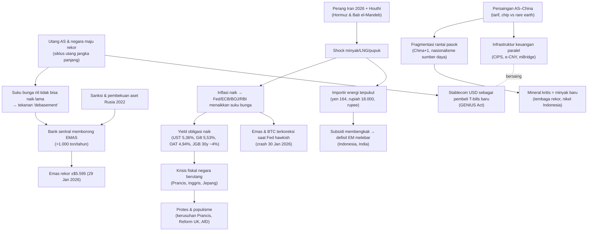

# Sintesis: Apa yang Sebenarnya Terjadi, Siapa yang Menggantikan, dan ke Mana Smart Money Bergerak

> Status: per 26 Oktober 2026 · Ini file **analisis**. Fakta berasal dari file-file topik (lihat tautan); penilaian, peluang, dan kesimpulan adalah interpretasi penulis menggunakan kerangka [Ray Dalio](kerangka-dalio.md).
> Fokus: pemahaman makro, **bukan saran investasi**.

## 1. Gambaran besar dalam satu paragraf

Dunia sedang berada di **fase akhir tatanan pasca-1945/pasca-1991 yang dipimpin AS** dan memasuki **tatanan multipolar yang belum terbentuk**. Kekuatan dominan (AS) masih paling kuat secara militer, teknologi, dan keuangan, tetapi **keuangannya memburuk** (defisit $2 triliun, bunga utang >$1 triliun) dan **kemampuannya menjamin "barang publik global"** (jalur laut aman, dolar netral, perdagangan bebas) **terkikis**: Hormuz dan Laut Merah terganggu, aset Rusia dibekukan, tarif dipakai sebagai senjata. Penantang utama (China) **unggul dalam produksi dan sebagian teknologi**, tetapi **terkekang** oleh kontrol modal, krisis properti, dan demografi. Jadi **tidak ada satu negara yang siap menggantikan AS** dalam 5–10 tahun. Yang terjadi adalah **fragmentasi**: blok-blok dan negara "jembatan", dengan **aset netral (emas)** sebagai penerima manfaat terbesar dari hilangnya kepercayaan.

## 2. Benang merah: semua ini memang berkorelasi

Anda benar bahwa perang, mata uang, dan komoditas saling terhubung. Rantainya kira-kira seperti ini:

**Inti korelasinya:**
1. **Perang menghasilkan inflasi, inflasi menaikkan suku bunga, dan suku bunga tinggi menghasilkan krisis fiskal di negara berutang.** Inilah mengapa perang Iran (energi) membuat **Prancis rusuh** dan **gilt Inggris mencapai yield tertinggi sejak 2007**.
2. **Sanksi menghasilkan diversifikasi cadangan, dan emas adalah pemenangnya.** Bukan yuan, bukan BTC.
3. **Persaingan AS–China menghasilkan fragmentasi, dan negara pemilik sumber daya mendapat daya tawar** (Indonesia, Saudi, Chile, Kongo).
4. **Utang AS memerlukan pembeli baru.** AS menjawab dengan stablecoin, *financial repression*, dan mungkin tekanan pada sekutu (intervensi bersama yen, "investasi" Jepang, Saudi, dan UEA di AS).

## 3. Siapa yang akan menggantikan AS?

### Jawaban jujur: dalam 5–10 tahun, **tidak ada satu pengganti**. Yang muncul adalah **dunia multipolar dengan AS sebagai "yang pertama di antara yang setara"**.

| Kandidat | Kekuatan | Kelemahan fatal (untuk 10 tahun ke depan) | Peran yang paling mungkin |
|---|---|---|---|
| **China** | Produksi, perdagangan, EV/baterai/surya, infrastruktur, AI terbuka | Kontrol modal, yuan tidak konvertibel, properti, demografi, kepercayaan hukum | **Kutub kedua**: pusat blok perdagangan Global South; pemimpin teknologi energi |
| **Uni Eropa** | Supremasi hukum, pasar besar, euro | Tidak ada kesatuan fiskal dan militer, energi, inovasi | **Kutub ketiga yang lemah**; euro sebagai alternatif kecil |
| **India** | Demografi, pertumbuhan 7%+, posisi swing | Masih miskin per kapita, rupee kecil | **Kekuatan naik**; kutub penting pada 2035–2050 |
| **Teluk** | Modal, energi | Kecil, rentan secara militer | Pemodal dan penentu harga energi |
| **Emas** (aset, bukan negara) | Netral, tidak bisa dibekukan | Tidak berbunga, tidak bisa menjadi alat pembayaran sehari-hari | **Jangkar kepercayaan** di sistem multipolar |
| **Bitcoin/stablecoin** | Digital, global | BTC volatil dan tidak dipegang bank sentral; stablecoin = dolar | Stablecoin **memperluas** dolar; BTC adalah opsi lindung nilai |

**Pola sejarah (Dalio):** transisi Inggris ke AS butuh ±40 tahun (1914–1956) dan **dua perang dunia**. Kita mungkin baru berada di **dekade pertama atau kedua** transisi berikutnya (mulai 2008). Pertanyaan kuncinya adalah **apakah transisi ini melibatkan perang besar AS–China** (Taiwan). Data 2026 menunjukkan kedua pihak masih menghindarinya (gencatan dagang diperpanjang, pejabat AS menilai invasi sebelum 2028 kecil kemungkinannya).

## 4. Ke mana "smart money" bergerak? (bukti 2025–2026)

| Pelaku | Aliran yang terlihat | Bukti | Makna |
|---|---|---|---|
| **Bank sentral dunia** | **Ke emas**, keluar perlahan dari UST | Rekor 289 ton Q2 2026; ±63 ton September; porsi USD di cadangan 56,7% | Paling jelas: **mengurangi risiko pihak lawan dan sanksi** |
| **China (negara)** | Keluar dari UST (−13% yoy), ke emas, cadangan minyak, infrastruktur CIPS/e-CNY | TIC, PBoC, mBridge | Bersiap untuk skenario sanksi atau konflik |
| **Investor Jepang** | Mulai **pulang** (JGB 30 tahun ±4%); intervensi menjual cadangan USD | MOF ¥11,7 triliun intervensi; kepemilikan UST −3% | Risiko bagi yield global |
| **Dana kekayaan Teluk** | Ke AS (AI, chip, infrastruktur) sebagai "asuransi politik"; memangkas proyek domestik | Janji investasi ke AS; NEOM dipangkas | Modal mengikuti **perlindungan militer** |
| **Modal daratan China** | Ke **saham Hong Kong** (Southbound HK$214,7 miliar) dan IPO teknologi | HKMA | Taruhan pada AI dan teknologi China |
| **Institusi Barat** | AI dan semikonduktor (sampai keraguan Oktober 2026); **tembaga dan logam** (rekor); obligasi korporasi AI > gilt | S&P 7.600+, tembaga $14.875 | Taruhan pada AI, tetapi mulai ada keraguan |
| **Ritel EM** | **Stablecoin USD** ($300 miliar), emas fisik (bar dan koin Q1 rekor kedua) | DefiLlama, WGC | Dolarisasi digital + lindung nilai emas |
| **Orang kaya global** | Ke **Singapura, Swiss**, sebagian Dubai (terpukul perang) | Family office, franc dan SGD kuat | Mencari yurisdiksi netral dan stabil |
| **ETF/pasar BTC** | Arus keluar 2026 (pasar bearish); Strategy menjual sedikit | ETF outflows rekor (Juni) | BTC **belum** menjadi safe haven krisis |
| **Investor asing di Indonesia** | **Keluar** (MSCI, IHSG −11,6%) | MSCI 15 Okt 2026 | Tata kelola pasar diragukan |

### Pola besar smart money 2026
1. **Dari aset "janji" (obligasi negara berutang) ke aset "nyata"** (emas, logam, energi, infrastruktur).
2. **Dari yurisdiksi berisiko politik ke yurisdiksi netral** (Swiss, Singapura).
3. **Dari "global" ke "blok"**: modal makin mengikuti garis aliansi.
4. **Tetapi masih ke AS untuk inovasi** (AI): AS tetap magnet modal pertumbuhan.

## 5. Siapa pemenang dan pecundang relatif (2026–2035, perkiraan)

| Relatif menang | Mengapa |
|---|---|
| **Pemilik energi non-Teluk** (AS, Kanada, Norwegia, Brasil, Guyana) | Premi risiko Teluk |
| **Pemilik mineral kritis** (Australia, Chile, Indonesia, Kongo) | Supercycle elektrifikasi dan AI, bila tata kelolanya baik |
| **Negara netral dan disiplin** (Swiss, Singapura) | Tempat berlindung modal |
| **India** | Demografi, posisi swing, menerima relokasi rantai pasok |
| **Emas** | Aset cadangan netral |

| Relatif kalah | Mengapa |
|---|---|
| **Negara maju berutang tinggi dengan pertumbuhan rendah** (Prancis, Inggris, Jepang, Italia) | r > g; ruang pajak habis; protes |
| **Importir energi tanpa bantalan** (Pakistan, Mesir, Bangladesh, Sri Lanka) | Shock energi dan pangan |
| **Pemegang obligasi jangka panjang negara maju** (dalam nilai riil) | *Financial repression* |
| **Rusia** | Ekonomi perang menipis, menjadi mitra junior China |
| **Eropa industri** (Jerman) | Energi mahal dan persaingan China |

**Posisi Indonesia:** berpotensi **menang** (nikel, tembaga, batu bara, CPO, demografi, posisi netral) **tetapi** saat ini **dihantam** shock energi (importir minyak; **defisit transaksi berjalan rekor 3,3% PDB pada Q2 2026**), tekanan fiskal (MBG, subsidi, rasio pajak 10%), dan krisis kepercayaan pasar (MSCI; IHSG ±−37% YTD; asing jual bersih ±Rp88 triliun). Hasil akhirnya **ditentukan oleh tata kelola**: disiplin fiskal, independensi BI, dan transparansi pasar modal. Lihat [Indonesia](../05-negara/indonesia.md).

## 6. Pertanyaan Anda: "pendapatan harus naik atau pengeluaran mengecil, sampai kapan?"

Ringkasan per negara:

| Negara | Defisit | Strategi sekarang | Batas | "Solusi nyata" yang paling mungkin |
|---|---|---|---|---|
| **AS** | ±6,3% PDB | Tarif (dibatalkan MA), stablecoin, tekanan ke Fed, berharap pada AI | Bunga > pertahanan; term premium naik | **Inflasi dan *financial repression*** (+ harapan AI) |
| **Prancis** | 5,4% | Pemangkasan €54 miliar, lalu kerusuhan | Pajak sudah ±46% PDB; tidak ada mayoritas | **Krisis yang memaksa** (2027) atau bantuan Eropa |
| **Inggris** | ±4,4% | Kenaikan pajak berulang | *Headroom* ±£12 miliar; gilt 5,5% | Pertumbuhan atau krisis gilt; reintegrasi dengan UE |
| **Jerman** | 3% menuju 4,6% | **Ekspansi** (€500 miliar, pertahanan) | Rem utang dilonggarkan; ruang fiskal masih ada | Investasi publik (butuh eksekusi) |
| **Jepang** | Defisit primer kronis | Stimulus + BOJ normalisasi + intervensi | Yield JGB naik; yen lemah | **Inflasi menggerus utang** (sedang berjalan) |
| **China** | ±9% (luas) | Obligasi khusus, teknologi, ekspor | Properti, deflasi, LGFV | Rebalancing ke konsumsi (sulit secara ideologis) |
| **Indonesia** | 2,85% (batas 3%) **+ defisit transaksi berjalan 3,3% PDB (Q2 2026, rekor)** | Pro-pertumbuhan, Danantara, efisiensi, DHE | Rasio pajak 10%; batas legal 3%; ketergantungan modal asing yang sedang keluar | **Menaikkan rasio pajak** dan memangkas subsidi; atau melanggar 3% |
| **Rusia** | 3,5–4,4% | Pajak naik, NWF, yuan | NWF menipis | **Mengakhiri/membekukan perang** |
| **Arab Saudi** | SAR 245 miliar (4,9% PDB); PDB riil −3,6% | Berutang, memangkas megaproyek | Breakeven $86,6; volume terganggu | Utang + penyesuaian Vision 2030 |
| **Singapura, Swiss, Hong Kong** | Surplus/seimbang | Cadangan besar | — | Tidak mendesak |

**Pola umum:** negara maju yang tidak bisa menaikkan pajak lagi dan tidak bisa memangkas belanja secara politik akan **memilih inflasi**, bukan default. Ini konsisten dengan pola Dalio: bunga riil ditekan dan mata uang tergerus perlahan. **Pihak yang dirugikan adalah penabung dalam kas dan obligasi jangka panjang.** Pihak yang diuntungkan secara relatif adalah pemilik aset riil dan langka.

## 7. Tiga skenario dunia 2026–2035

| Skenario | Peluang | Ciri |
|---|---|---|
| **A. "Multipolar keruh" (dasar)** | **±55%** | Konflik regional kronis (Iran, Ukraina beku, Laut Merah); AS–China bersaing tanpa perang; inflasi struktural 3–4%; *financial repression*; emas dan komoditas kuat; dolar tetap dominan tetapi menyusut perlahan |
| **B. "Kebangkitan teknologi"** | ±20% | AI menaikkan produktivitas, defisit mengecil, perdamaian Iran; dolar dan saham AS menguat; emas konsolidasi |
| **C. "Krisis transisi"** | ±25% | Salah satu atau lebih: krisis UST/JGB/OAT, perang Taiwan, eskalasi Teluk. Terjadi lompatan ke sistem baru (kontrol modal, revaluasi emas, blok terpisah) |

## 8. Daftar indikator utama ("dasbor" pribadi)

1. **Yield UST 10 dan 30 tahun + DXY**: apakah keduanya bergerak berlawanan arah (tanda bahaya)?
2. **Pembelian emas bank sentral** (WGC kuartalan, PBoC bulanan)
3. **Transit Hormuz dan Bab el-Mandeb** dan harga Brent
4. **Spread OAT–Bund dan yield gilt** (stres fiskal Eropa)
5. **USD/JPY dan yield JGB 30 tahun** (repatriasi Jepang)
6. **Gencatan dagang AS–China** (10 Januari 2027) dan lisensi rare earth
7. **Arus ETF dan kapitalisasi stablecoin** (selera risiko dan dolarisasi digital)
8. **Indonesia:** cadangan devisa, **defisit transaksi berjalan**, defisit APBN vs 3%, keputusan MSCI (Juni 2027), BI-Rate, arus asing

Nilai terkini semua indikator ada di [dashboard 14 indikator](../07-tinjauan-eksternal/geopolitics-for-dummies-vol1.md#dashboard-14-indikator-versi-perbaikan-dengan-nilai-terkini).

### Rezim makro saat ini (*Four Quadrant*: pertumbuhan × inflasi)

| Kawasan | Pertumbuhan | Inflasi | Kuadran | Aset yang secara historis diuntungkan |
|---|---|---|---|---|
| Zona euro, Inggris, Jepang | Lemah | Naik (3–4%) | **Quad 3: stagflasi** | Emas, komoditas, aset berdurasi pendek |
| AS | Masih kuat (AI) | Naik (CPI 3,7%) | **Quad 2/3** | Komoditas, energi, sebagian saham |
| China | Stabil ±4,5% | Rendah, PPI mulai naik | **Quad 1/2** | Saham teknologi, ekspor |
| Indonesia | Melambat (5,6% → 5,3%) | Naik (3,28%) | **Mendekati Quad 3** | Emas (dalam rupiah), eksportir komoditas non-minyak |

*Kerangka kuadran dari tinjauan buku eksternal; penempatan berdasarkan data Q2–Q3 2026. Lihat [tinjauan](../07-tinjauan-eksternal/geopolitics-for-dummies-vol1.md).*

## 9. Keterbatasan riset ini

- Data akhir 2026 masih bergerak cepat. Banyak angka bersumber dari media sekunder dan sudah ditandai bila ada perbedaan.
- Peluang skenario adalah **penilaian subjektif**.
- Sejarah tidak berulang persis. AI, nuklir, dan iklim adalah faktor baru tanpa preseden.
- Ini **bukan nasihat investasi**.

## Tautan ke semua file

- Tinjauan eksternal: [Geopolitics for Dummies Vol. 1 (BlackQoral)](../07-tinjauan-eksternal/geopolitics-for-dummies-vol1.md), termasuk dashboard 14 indikator dengan nilai terkini
- Kerangka: [Kerangka Dalio](kerangka-dalio.md)
- Mata uang: [USD](../01-mata-uang/dolar-as.md) · [CNY](../01-mata-uang/yuan.md) · [JPY](../01-mata-uang/yen.md) · [EUR](../01-mata-uang/euro.md) · [GBP](../01-mata-uang/pound-sterling.md) · [IDR](../01-mata-uang/rupiah.md) · [CHF](../01-mata-uang/franc-swiss.md) · [SGD](../01-mata-uang/sgd-dolar-singapura.md) · [HKD](../01-mata-uang/hkd-dolar-hong-kong.md)
- Aset digital: [Bitcoin](../02-aset-digital/bitcoin.md) · [Stablecoin](../02-aset-digital/stablecoin.md) · [CBDC](../02-aset-digital/cbdc.md)
- Komoditas: [Emas](../03-komoditas/emas.md) · [Perak](../03-komoditas/perak.md) · [Minyak & Gas](../03-komoditas/minyak-gas.md) · [Logam & Mineral Kritis](../03-komoditas/logam-industri-mineral-kritis.md) · [Pangan & Pupuk](../03-komoditas/pangan-pupuk.md)
- Obligasi: [UST](../04-obligasi/us-treasury.md) · [JGB](../04-obligasi/jgb-jepang.md) · [Gilt](../04-obligasi/gilt-inggris.md) · [Bund/OAT/BTP](../04-obligasi/bund-oat-eropa.md) · [SBN](../04-obligasi/sbn-indonesia.md)
- Negara: [AS](../05-negara/amerika-serikat.md) · [China](../05-negara/china.md) · [Jepang](../05-negara/jepang.md) · [Indonesia](../05-negara/indonesia.md) · [Inggris](../05-negara/inggris.md) · [Jerman](../05-negara/jerman.md) · [Prancis](../05-negara/prancis.md) · [UE](../05-negara/uni-eropa.md) · [Singapura](../05-negara/singapura.md) · [Hong Kong](../05-negara/hong-kong.md) · [Rusia](../05-negara/rusia.md) · [India](../05-negara/india.md) · [Saudi & UEA](../05-negara/arab-saudi-uea.md) · [Swiss](../05-negara/swiss.md)
- Konflik: [Iran–AS–Israel](../06-konflik/iran-israel-as-hormuz.md) · [Rusia–Ukraina](../06-konflik/rusia-ukraina.md) · [Houthi/Laut Merah](../06-konflik/houthi-laut-merah.md) · [Taiwan/LCS](../06-konflik/taiwan-laut-china-selatan.md) · [India–Pakistan](../06-konflik/india-pakistan.md) · [Venezuela](../06-konflik/venezuela-amerika-latin.md) · [Sudan/Sahel](../06-konflik/sudan-sahel-afrika.md)
