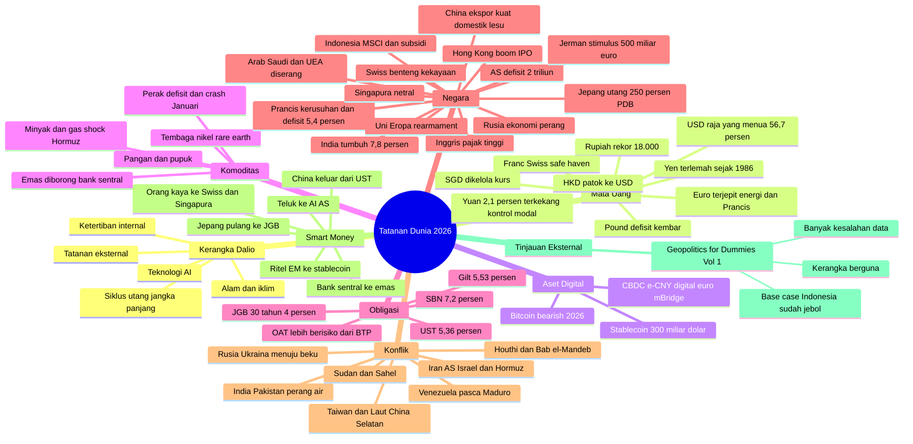

# Riset Tatanan Dunia 2026: Geopolitik, Mata Uang, Komoditas & Pergerakan Smart Money

> **Status data:** per 26 Oktober 2026 · **Bahasa:** Indonesia · **Kerangka:** Siklus Besar Ray Dalio
> **Tujuan:** memahami apa yang sebenarnya terjadi di dunia (sejarah, kondisi sekarang, proyeksi 5–10 tahun) dan ke mana arah tatanan dunia bergerak. **Bukan saran investasi.**

## Mulai dari sini

1. **[Sintesis: apa yang terjadi, siapa pengganti AS, ke mana smart money bergerak](00-kerangka/sintesis-tatanan-dunia.md)** ← baca ini dulu
2. [Kerangka analisis Ray Dalio](00-kerangka/kerangka-dalio.md)
3. **[Tinjauan kritis buku *Geopolitics for Dummies Vol. 1*](07-tinjauan-eksternal/geopolitics-for-dummies-vol1.md)**: perbandingan, kesalahan data, insight, dan dashboard 14 indikator dengan nilai terkini
4. Mind map interaktif: `mindmap.html` (buka di browser) atau mind map Mermaid di bawah

## 10 temuan utama (Oktober 2026)

1. **Perang Iran–AS/Israel (sejak 28 Feb 2026)** menutup sebagian Selat Hormuz. IEA menyebutnya gangguan pasokan minyak **terbesar dalam sejarah**. Brent sempat ±$118–126 dan kembali ±$110–117 pada Oktober. → [detail](06-konflik/iran-israel-as-hormuz.md)
2. **Inflasi kembali, bank sentral menaikkan suku bunga:** Fed naik ke 3,75–4,00% (Sep), ECB ke 2,5%, BOJ ke 1,25% (tertinggi 31 tahun), RBI ke 5,5%.
3. **Pasar obligasi negara maju tertekan:** UST 10 tahun **5,36%** (tertinggi sejak 2002), gilt **5,53%** (tertinggi sejak 2007), OAT Prancis **4,94%** (tertinggi sejak 2002, lebih berisiko dari Italia), JGB 30 tahun ±4%.
4. **AS: defisit $1,99 triliun, bunga utang $1,05 triliun > anggaran pertahanan.** Mahkamah Agung membatalkan tarif IEEPA (Feb 2026). Kevin Warsh menjadi Ketua Fed. → [AS](05-negara/amerika-serikat.md)
5. **Bank sentral memborong emas:** rekor 289 ton (Q2 2026). Emas mencapai rekor ±$5.595 (29 Jan 2026), crash 10% saat Warsh dinominasikan, titik terendah ±$3.995 (Juni), lalu ±$4.100 (Okt). → [Emas](03-komoditas/emas.md)
6. **Dolar masih raja yang menua:** porsi cadangan 56,7%, yuan hanya 2,1%. Penerima manfaat dedolarisasi adalah **emas**, bukan yuan. → [USD](01-mata-uang/dolar-as.md), [Yuan](01-mata-uang/yuan.md)
7. **Bitcoin pasar bearish** (<$59.000 pada Juni, ±$81.000 pada Okt) dan **belum** menjadi safe haven krisis. **Stablecoin $300 miliar** memperluas dolar secara digital; aturan GENIUS final berlaku Jan 2027. → [BTC](02-aset-digital/bitcoin.md), [Stablecoin](02-aset-digital/stablecoin.md)
8. **Eropa terjepit:** kerusuhan BBM di Prancis (17 & 24 Okt), Inggris paling terpukul shock energi, Jerman bertaruh €500 miliar pada stimulus. → [Prancis](05-negara/prancis.md)
9. **Asia importir energi terpukul:** yen ¥164 (terlemah sejak 1986) memicu **intervensi bersama AS–Jepang** (pertama sejak 2011); **rupiah ±Rp18.000** (rekor); **MSCI mengancam mengeluarkan Indonesia** dari EM (IHSG −11,6% dalam sehari, terburuk sejak 1998; ±−37% YTD). **Defisit transaksi berjalan Indonesia rekor 3,3% PDB** (Q2 2026) karena impor minyak, jadi Indonesia **bukan** "commodity winner" kali ini. → [Rupiah](01-mata-uang/rupiah.md), [Indonesia](05-negara/indonesia.md)
10. **AS–China: perang dingin terkelola:** gencatan dagang diperpanjang hanya sampai 10 Jan 2027; chip vs rare earth; latihan militer di sekitar Taiwan. **Tembaga rekor** ($14.875) karena AI. → [Taiwan/perang dagang](06-konflik/taiwan-laut-china-selatan.md)

## Mind map



## Struktur folder

```
riset-tatanan-dunia/
├── README.md                      ← indeks & mind map (file ini)
├── mindmap.html                   ← mind map interaktif
├── 00-kerangka/
│   ├── kerangka-dalio.md          ← teori Siklus Besar
│   └── sintesis-tatanan-dunia.md  ← KESIMPULAN: korelasi, pengganti AS, smart money
├── 01-mata-uang/                  ← USD, CNY, JPY, EUR, GBP, IDR, CHF, SGD, HKD
├── 02-aset-digital/               ← Bitcoin, Stablecoin, CBDC
├── 03-komoditas/                  ← Emas, Perak, Minyak & Gas, Logam/Mineral Kritis, Pangan & Pupuk
├── 04-obligasi/                   ← UST, JGB, Gilt, Bund/OAT/BTP, SBN
├── 05-negara/                     ← 14 negara/blok
├── 06-konflik/                    ← 7 konflik
└── 07-tinjauan-eksternal/         ← tinjauan kritis analisis/buku dari luar
```

## Daftar lengkap file

| Kategori | File |
|---|---|
| **Kerangka** | [Kerangka Dalio](00-kerangka/kerangka-dalio.md) · [Sintesis](00-kerangka/sintesis-tatanan-dunia.md) |
| **Mata uang** | [Dolar AS](01-mata-uang/dolar-as.md) · [Yuan](01-mata-uang/yuan.md) · [Yen](01-mata-uang/yen.md) · [Euro](01-mata-uang/euro.md) · [Pound](01-mata-uang/pound-sterling.md) · [Rupiah](01-mata-uang/rupiah.md) · [Franc Swiss](01-mata-uang/franc-swiss.md) · [SGD](01-mata-uang/sgd-dolar-singapura.md) · [HKD](01-mata-uang/hkd-dolar-hong-kong.md) |
| **Aset digital** | [Bitcoin](02-aset-digital/bitcoin.md) · [Stablecoin](02-aset-digital/stablecoin.md) · [CBDC](02-aset-digital/cbdc.md) |
| **Komoditas** | [Emas](03-komoditas/emas.md) · [Perak](03-komoditas/perak.md) · [Minyak & Gas](03-komoditas/minyak-gas.md) · [Logam & Mineral Kritis](03-komoditas/logam-industri-mineral-kritis.md) · [Pangan & Pupuk](03-komoditas/pangan-pupuk.md) |
| **Obligasi** | [US Treasury](04-obligasi/us-treasury.md) · [JGB](04-obligasi/jgb-jepang.md) · [Gilt](04-obligasi/gilt-inggris.md) · [Bund/OAT/BTP](04-obligasi/bund-oat-eropa.md) · [SBN](04-obligasi/sbn-indonesia.md) |
| **Negara** | [AS](05-negara/amerika-serikat.md) · [China](05-negara/china.md) · [Jepang](05-negara/jepang.md) · [Indonesia](05-negara/indonesia.md) · [Inggris](05-negara/inggris.md) · [Jerman](05-negara/jerman.md) · [Prancis](05-negara/prancis.md) · [Uni Eropa](05-negara/uni-eropa.md) · [Singapura](05-negara/singapura.md) · [Hong Kong](05-negara/hong-kong.md) · [Rusia](05-negara/rusia.md) · [India](05-negara/india.md) · [Arab Saudi & UEA](05-negara/arab-saudi-uea.md) · [Swiss](05-negara/swiss.md) |
| **Tinjauan eksternal** | [Geopolitics for Dummies Vol. 1 (BlackQoral)](07-tinjauan-eksternal/geopolitics-for-dummies-vol1.md) |
| **Konflik** | [Iran–AS–Israel & Hormuz](06-konflik/iran-israel-as-hormuz.md) · [Rusia–Ukraina](06-konflik/rusia-ukraina.md) · [Houthi & Laut Merah](06-konflik/houthi-laut-merah.md) · [Taiwan & LCS](06-konflik/taiwan-laut-china-selatan.md) · [India–Pakistan](06-konflik/india-pakistan.md) · [Venezuela](06-konflik/venezuela-amerika-latin.md) · [Sudan & Sahel](06-konflik/sudan-sahel-afrika.md) |

## Format setiap file

Setiap file topik mengikuti struktur yang sama supaya mudah dibandingkan:
1. **Ringkasan** + tabel data 2026
2. **Sejarah** (posisi dalam siklus)
3. **Kondisi sekarang** / sumber pendapatan dan defisit (untuk negara)
4. **Korelasi** dengan topik lain (dengan tautan)
5. **Lensa Ray Dalio**
6. **Skenario 5–10 tahun** dengan perkiraan peluang (penilaian subjektif)
7. **Indikator yang perlu dipantau**
8. **Sumber** (tautan)

## Cara memperbarui temuan

- Tambahkan temuan baru ke file topik terkait di bagian yang sesuai, lalu perbarui baris "Status data" di atasnya.
- Jika temuan mengubah gambaran besar, perbarui [Sintesis](00-kerangka/sintesis-tatanan-dunia.md) dan "10 temuan utama" di file ini.
- Jika ada angka yang berbeda antarsumber, tulis keduanya dan sebutkan sumbernya.

## Log pembaruan

| Tanggal | Perubahan |
|---|---|
| 26 Okt 2026 (v1) | Riset awal: 46 file + mind map |
| 26 Okt 2026 (v2) | **Tinjauan kritis *Geopolitics for Dummies Vol. 1*** (15 kesalahan data terverifikasi, 9 misinterpretasi konsep, uji realitas skenario). **Verifikasi ulang data riset:** rekor emas dikoreksi ke ±$5.595 (dari ±$5.600) dan titik terendah Juni ±$3.995 ditambahkan; pagu MBG dikoreksi ke Rp268 triliun (setelah dipangkas dari Rp335 triliun); defisit Saudi kini dari dokumen resmi (4,9% PDB, PDB riil −3,6%). **Data baru:** defisit transaksi berjalan Indonesia rekor 3,3% PDB (Q2 2026), IHSG 5.387,9 (±−37% YTD), jual bersih asing ±Rp88 triliun, inflasi Indonesia 3,28%, Brent settle $116,72 (23 Okt), PMI China 50,1, rezim makro *Four Quadrant* |

## Kalender peristiwa penting berikutnya

| Tanggal | Peristiwa |
|---|---|
| 28 Okt 2026 | Keputusan Fed · APBN Musim Gugur Inggris |
| 29 Okt 2026 | Keputusan ECB |
| 29–30 Okt 2026 | Keputusan BOJ |
| 31 Okt 2026 | "Act III" protes Prancis |
| 3 Nov 2026 | **Pemilu sela AS** |
| ±5 Nov 2026 | PDB Indonesia Q3 (BPS) · BoE |
| Paruh I Nov 2026 | Perundingan damai AS–Rusia–Ukraina (Abu Dhabi) |
| Nov 2026 | KTT APEC Shenzhen (Trump–Xi) |
| 10 Des 2026 | Keputusan SNB |
| Des 2026 | IMF COFER Q3 · rapat Fed |
| 10 Jan 2027 | Gencatan dagang AS–China berakhir (kecuali diperpanjang) |
| 18 Jan 2027 | Aturan GENIUS Act berlaku |
| Apr–Mei 2027 | **Pilpres Prancis** |
| 30 Jun 2027 | Keputusan MSCI tentang Indonesia |
